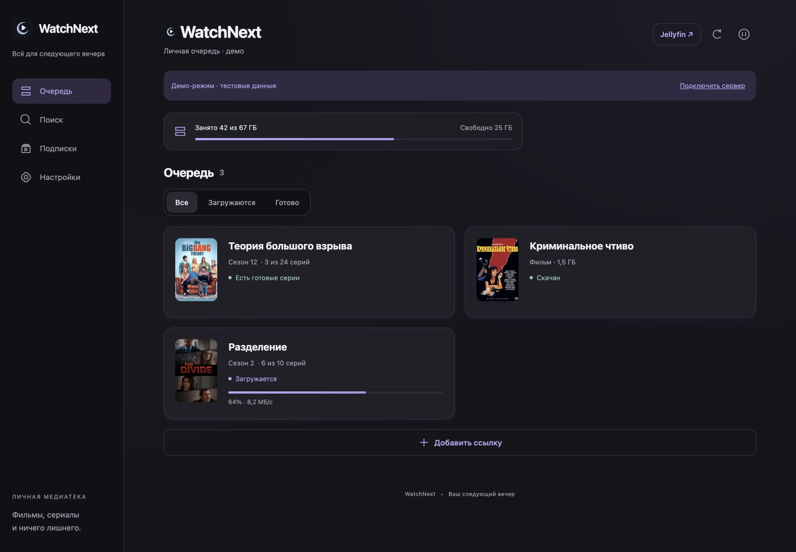
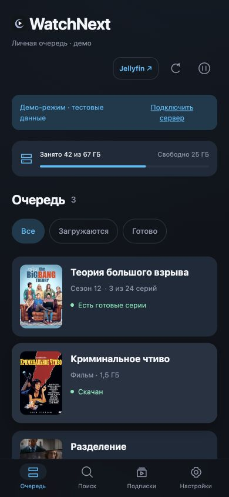

# WatchNext

Домашний кинотеатр с веб-интерфейсом, REST API и опциональным Telegram-ботом: хранит ограниченное число серий или гигабайт, удаляет просмотренное и загружает продолжение. Поддерживает фильмы, поиск раздач, общий доступ для семьи и уведомления о новых сериях.

**Стек:** Ubuntu · Docker Compose · qBittorrent · Jellyfin · Jackett · Python/FastAPI · Node.js 22.

В Telegram доступны `/discover` (персоны и подборки), `/random` (фильмы по фильтрам), `/person Имя` и `/watched`. Каталог, TMDB и просмотренное общие с вебом. [Подробности работы бота](docs/WEB.md#telegram-те-же-каталог-и-история).

## Как это выглядит



<details>
<summary>Интерфейс на телефоне</summary>



</details>

[Проверка интерфейса и оставшиеся идеи](docs/WEB-UI-REVIEW.md).

1. В веб-интерфейсе или Telegram находишь фильм или сериал, выбираешь раздачу и начальную серию.
2. Бот скачивает только выбранные файлы в пределах общего лимита и показывает готовое в Jellyfin.
3. Смотришь через Jellyfin на Android TV, webOS, телефоне или в браузере.
4. После просмотра и завершения воспроизведения бот выжидает 2 минуты, удаляет файл и загружает следующую серию.

Готовые файлы публикуются через жёсткие ссылки: второй копии видео нет. Когда выбранные файлы скачаны, торрент останавливается; после освобождения места запускается автоматически. Во время загрузки клиент может отдавать уже скачанные части.

## Быстрая установка

Нужен Ubuntu 22.04/24.04 x86-64, Python 3 и место на диске. На этой конфигурации проверена установка. Другие Linux/архитектуры требуют самостоятельной проверки образов; Docker Desktop и аппаратное перекодирование установщик не настраивает.

Веб устанавливается вместе с сервером и доступен на `http://IP_МИНИ_ПК:8787`. Токены TMDB и Telegram можно добавить позже в настройках. [Настройки, запуск и переходы в Jellyfin](docs/WEB.md).

```bash
git clone https://github.com/shadowkka/watchnext.git
cd watchnext
bash install.sh
```

Запускай обычным пользователем, **без `sudo`**. Если Docker отсутствует, установщик предложит установить его из официального apt-репозитория. Если Docker требует привилегий, команды Docker будут выполняться через `sudo`; права на папку проекта останутся у твоего пользователя.

Установщик спросит:

- IP мини-ПК и папку для видео;
- порты сервисов — можно оставить предложенные, если они свободны;
- общий профиль Jellyfin и пароль для телевизора;
- токен бота; затем попросит отправить `/start` и выбрать свой аккаунт;
- лимит серий, общий объём в ГБ и резерв свободного места.

Дальше он настроит qBittorrent, Jellyfin, библиотеки «Сериалы» и «Фильмы», API-ключи, Jackett/FlareSolverr, попробует подключить RuTor и запустит бота. Пароли и токены вводятся локально и не выводятся в лог. Учётные данные сохраняются в `access.txt`, настройки — в `.env`, оба файла доступны только владельцу и исключены из Git.

Первый запуск скачивает Docker-образы и может занять несколько минут. При ошибке исправь указанную причину и повтори `bash install.sh`: сохранённые настройки используются повторно. После успешной установки повторный запуск ничего не перенастраивает.

### После установки

- Отправь боту **`/menu`**.
- Подключи клиент Jellyfin к адресу, который показал установщик: обычно `http://IP_МИНИ_ПК:8096`.
- Для общего доступа отправь **`/invite`** и передай одноразовую ссылку близкому. Оба смотрят под общим профилем Jellyfin.
- Для RuTracker открой Jackett: обычно `http://IP_МИНИ_ПК:9117/UI/Dashboard`, добавь индексатор и войди там. CAPTCHA вводится вручную. Отключи **Strip Russian Letters**, чтобы сохранялись названия и студии озвучки.

Сервисы рассчитаны на домашнюю сеть или личный VPN. Docker публикует порты независимо от некоторых правил UFW; проверь сетевой доступ, если устанавливаешь на сервер с публичным интерфейсом. Установщик не настраивает публикацию в интернет.

## Что умеет бот

| Команда / кнопка | Что делает |
| --- | --- |
| `/search` | Поиск фильма или сериала: качество, озвучки, размер, сиды и пиры; выбор кнопками |
| **🧲 Magnet** / `/add` | Пошаговое добавление по magnet |
| `/files` | Выбор раздачи по названию и список файлов |
| `/from` | Изменение начального сезона и серии |
| `/status` | Общая очередь, готовые серии и свободное место |
| `/limit` | Количество серий, ГБ или оба ограничения |
| `/reserve` | Резерв свободного диска |
| `/subscriptions`, `/follow` | Подписки на выход серий и появление подходящих раздач |
| `/pause`, `/resume` | Общая пауза и продолжение |
| `/retry` | Восстановление удалённого задания или повтор разбора |
| `/finish` | Отключение запроса следующего сезона для раздачи |
| `/invite`, `/users` | Семейный доступ; управление — только владелец |
| `/cancel` | Отмена текущего ввода |

Меню не требует ввода hash/ID раздач. В поиске можно поднимать, например, 1080p выше остальных и фильтровать по качеству, минимальным сидам и размеру. Озвучка выбирается только для текущего поиска: отдельно студия, тип перевода MVO/DVO/AVO/VO/DUB или явно указанный язык аудио.

### Лимиты и удаление

Количество ограничивает **серии**, фильмы его не занимают. Лимит ГБ — общий для фильмов и серий, включая выбранные незавершённые файлы. Размер считается целиком до начала загрузки; уже выбранные файлы не удаляются при снижении лимита. ГБ десятичные: 1 ГБ = 1 000 000 000 байт.

Просмотр определяется по общему профилю Jellyfin. Ручная отметка «просмотрено» тоже приводит к удалению. Активное воспроизведение защищено; задержка перед удалением — 120 секунд. При ручном удалении из Jellyfin бот убирает и исходник. Если файл исчез одновременно в библиотеке и загрузках, операция останавливается для проверки диска.

Удалённая вручную раздача qBittorrent сама не возвращается: её можно восстановить через `/files`. Чужие задания qBittorrent бот под управление не забирает. Используй выделенный экземпляр из Compose: бот меняет его настройки путей и выборочного хранения.

### Подписки

В `/subscriptions` найди и подтверди сериал, выбери качество и озвучку, затем включи подписку. Можно подписаться из карточки уже добавленного сериала. Подписки общие для семьи.

Раз в 2 часа бот проверяет расписание TVmaze и раздачи Jackett:

- серия вышла, но перевода ещё нет → **«Серия вышла — ждём озвучку»**;
- подходящая раздача появилась → **«Раздача найдена»** с кнопкой выбора;
- первая серия нового сезона помечается отдельно.

Загрузка начинается только после подтверждения. Если раздача уже есть при первой проверке, лишнего сообщения об ожидании не будет. Старые серии до включения подписки не предлагаются. Нужен доступ к `api.tvmaze.com:443`; при ошибке повтор — через 15 минут. Даты расписания не гарантируют наличие перевода.

## Ограничения

- Поддерживаются magnet и torrent v1/hybrid с BTIH; чистый v2 — нет.
- Несколько сезонов и объединённые серии поддерживаются. Двойная серия занимает два места и удаляется целиком.
- Для фильма выбирается самый крупный видеофайл без сэмплов/трейлеров.
- Внешние субтитры не выбираются автоматически; встроенные сохраняются.
- Аппаратное перекодирование Jellyfin настраивается отдельно. Доступность клиента webOS зависит от телевизора/региона.
- Озвучки и номера в поиске извлекаются из заголовков. При отсутствии данных бот сообщает об этом; полный список проверяется после получения метаданных торрента.
- До 20 подписок; специальные эпизоды сезона 0 не отслеживаются.
- Нельзя распределять `downloads`, `library` и `movies` по разным файловым системам: публикация использует hardlink.

## Документация

- [Установка и ручная настройка](docs/INSTALLATION.md)
- [Обслуживание, резервные копии, обновление и удаление](docs/OPERATIONS.md)
- [Типовые проблемы](docs/TROUBLESHOOTING.md)
- [Архитектура](docs/ARCHITECTURE.md)
- [Краткая карта для ИИ и разработчиков](AGENTS.md)

## Разработка

```bash
python3 -m unittest discover -s tests -v
bash -n install.sh scripts/install-docker-ubuntu.sh
```

Python 3.10+; сторонние Python-пакеты не нужны. Тесты используют собственные фикстуры, не скачивают внешнее видео и не требуют токенов. Проверка настоящей первичной настройки qBittorrent/Jellyfin описана в [документации разработчика](docs/ARCHITECTURE.md).

Код проекта — [MIT](LICENSE). Сервисы в Docker-образах распространяются по собственным лицензиям. Данные расписания — [TVmaze](https://www.tvmaze.com/), [CC BY-SA 4.0](https://creativecommons.org/licenses/by-sa/4.0/). Проект не содержит медиаконтента, учётных записей трекеров и готовых пользовательских конфигураций.

### Хочу посмотреть

В веб-интерфейсе и Android WebView можно сохранять фильмы и сериалы из результатов поиска раздач, фильмографий, подборок и случайных рекомендаций. Список доступен на странице поиска, а в случайном подборе — рядом с просмотренным. Из сохранённого можно перейти к поиску раздач или убрать запись. Добавление не запускает скачивание и не отмечает фильм просмотренным.

Список хранится на сервере в `PICKER_DATA_DIR/wishlist.json` (в Docker — в постоянном томе `/web-data/picker`) и сохраняется при обновлении контейнера. Для работ каталога используются ID; результаты трекеров без ID сохраняются по названию, году и типу.
