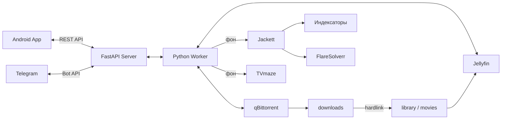

# Архитектура WatchNext

Для быстрого входа начни с [AGENTS.md](../AGENTS.md). Здесь — связи и состояния, которые важны при изменениях.

## Процесс и состояние

`server.py` запускает выделенный FastAPI REST API сервер (`/api/status`, `/api/packs`, `/api/search`, `/api/subscriptions`, `/api/limits`, OpenAPI `/docs`) для управления через Android-приложение (WatchNextApp) или Web.

В фоновом потоке запускается синхронизация: чтение Telegram updates (если настроен бот), применение поисковых/календарных запросов и вызов `Worker.tick` с интервалом около 20 секунд. Телеграм-бот и Android-приложение работают с единым состоянием и очередью. Если Telegram не настроен, сервер полноценно работает в режиме чистого REST API.

`Store` атомарно пишет `state/state.json` через временный файл, `fsync` и replace. Только основной поток меняет очередь и выполняет файловые операции. ThreadPoolExecutor используется для Jackett/TVmaze; результаты проверяются на актуальность перед применением.

В состоянии хранятся общие ограничения, пользователи/приглашения, список раздач, capability-кнопки, независимые диалоги/поиски пользователей и общий список подписок. Это приватная база приложения, не тестовая фикстура.

## Жизненный цикл раздачи

`metadata → ready → needcheck → checking → ready / retiring → complete`.

- `metadata`: magnet останавливается после получения метаданных; torrent-файл добавляется сразу stopped. Пока список не разобран, весь сезон не скачивается.
- `ready`: планировщик сохраняет резервации, выставляет приоритеты только выбранным видеофайлам и запускает загрузку, если есть незавершённый файл. Готовый файл публикуется hardlink. Все выбранные скачаны — stop.
- После решения о просмотре/ручном удалении: stop, исключение приоритетов, удаление обеих ссылок и recheck.
- `checking`: ждём, пока qBittorrent завершит проверку. Далее пополнение или очистка завершённой раздачи.
- `missing`: задание удалено из qBittorrent вручную. Автоматически не возвращается.

`core.plan` сохраняет уже выбранные файлы и резервирует новые с учётом количества серий, размера и свободного диска. У фильма `count_units=0`; у двойной серии — размер диапазона. Исходник и библиотека не удваивают байты на диске.

## Поиск

`search_client.Jackett` выполняет независимые запросы по индексаторам: сбой одного не уничтожает результаты другого. Возвращается до 500 нормализованных записей. Студии, типы перевода и явно указанные языки извлекаются из заголовка, данные не угадываются по названию фильма.

`SearchUI` хранит оригинальные индексы результатов: фильтрация и сортировка не меняют выбранный торрент. Обычные предпочтения сохраняются по пользователю, озвучка — по текущему поиску. Сессии действуют 24 часа.

Импорт требует явного `search_add`. Ссылки `.torrent` допускаются только на `/dl/` того же Jackett, а не на произвольные URL. Размер и bencode ограничены, BTIH вычисляется по исходным байтам `info`. Файл метаданных сохраняется для восстановления задания. qBittorrent 5.2.4 может отвечать JSON, а не `Ok.`.

## Подписки

TVmaze определяет сериал и даты; Jackett проверяет релизы. Подтверждённый ID каталога хранится отдельно от названия папки Jellyfin. Новая подписка исключает эпизоды, вышедшие до её включения. Проверка каждые 2 часа; ошибка — повтор через 15 минут. Две стадии уведомления имеют отдельную историю доставки каждому члену семьи.

Проверяется соответствие названия и диапазона серий. Целый сезон без диапазона не считается доказательством наличия произвольной поздней серии. Известные очереди эпизоды не предлагаются. Уведомление открывает существующий поиск с точной начальной позицией, но не добавляет торрент само.

При параллельном изменении настройки проверяются `generation` и `revision`. История отправок не затирается завершением фонового снимка. За один цикл ограничено количество отправок.

## Установщик

`install.sh` запускает `installer.py`. Мастер работает в отдельном checkout с собственным Compose project `watchnext`. Он проверяет порты, выбирает отдельную DNS-сеть и сохраняет секреты до внешних изменений. Сначала настраивает собственные новые сервисы, затем запускает worker. Пароли существующих чужих установок не сбрасывает. Файл `state/installation-complete.json` делает повторный завершённый запуск информационным.

Для smoke-проверки используй отдельную временную папку и отдельный `COMPOSE_PROJECT_NAME`, высокие свободные порты и новый `DATA_DIR`. `setup_qbit`/`setup_jellyfin` можно вызвать как функции с подготовленным синтетическим env. Не используй рабочий токен Telegram для второго poller. Не тестируй установщик поверх работающей домашней очереди.

## Тесты

Запуск всех проверок: `python3 -m unittest discover -s tests -q` из корня. Для точечного запуска добавляй `PYTHONPATH=.:tests`, если импортируется отдельный test-модуль. Тестовые внешние сервисы — fake-объекты, файлы — во временных папках. Installer отдельно проверяет хранение env, права, повторный запуск, подсети и отсутствие сброса существующих паролей.
